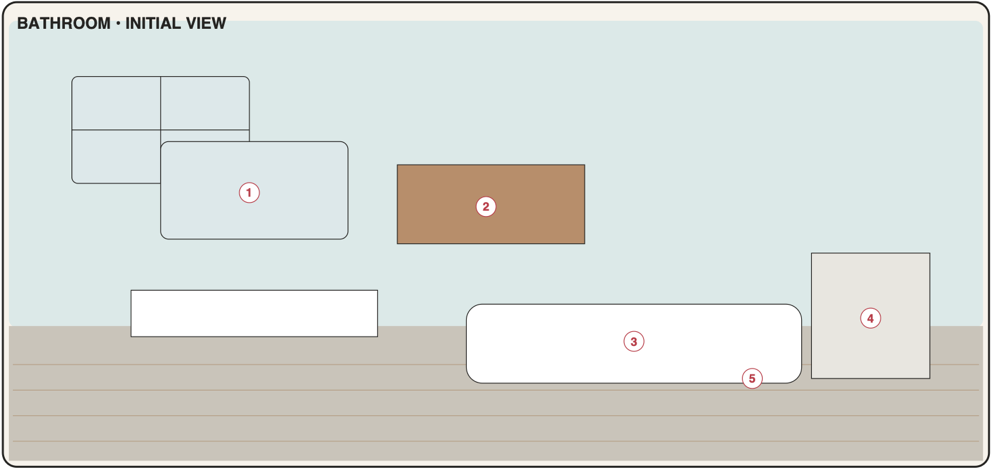

# Bathroom

A calm utility room for personal-care routines, supplies and laundry (PDF p7). Open from the start; the first visit runs the room tour. Ships in **Phase 4** together with the clothing shop and park.



## 1. Portrait layout

Palette: wall `#DDE7E6`, floor `#C9C3B8` (tiles), floor line at **y = 0.60**.

```text
┌────────────────────────────────────┐ 0.00
│ ┌──────────────┐   ┌───────────┐   │
│ │   [1] MIRROR │   │ [2] ▤ ▤ ▤ │   │ ← [2] bathroom cabinet (wall)
│ │      ✨      │   │  CABINET  │   │
│ │              │   └───────────┘   │
│ └──────────────┘                   │
│ ┌──────────────┐  towel rail       │
│ │   ◯ SINK     │            ┌─────┐│
│ └──┬────────┬──┘     ┌───┐  │ ◎   ││ ← [4] washing machine
│~~~~│~~~~~~~~│~~~~~~~~│[5]│~~│(  ) ││ 0.60
│    │        │        │🧺 │  │ [4] ││ ← [5] laundry basket
│    └────────┘        └───┘  └─────┘│
│  shower head ┐                     │
│ ┌────────────┴─────────────┐       │
│ │        [3] BATH / SHOWER │  🙂   │
│ └──────────────────────────┘  /|\  │
└────────────────────────────────────┘ 1.00
```

### 1.1 Object map

| Code | Object id | x | y | w | h | z | Window |
|------|-----------|---|---|---|---|---|--------|
| BA1 | `bathroom.mirror-sink` | 0.06 | 0.06 | 0.36 | 0.42 | 10 | `routines.care` |
| BA2 | `bathroom.cabinet` | 0.52 | 0.07 | 0.30 | 0.18 | 10 | `inventory.bathroom` |
| BA3 | `bathroom.bath-shower` | 0.04 | 0.74 | 0.64 | 0.20 | 10 | `routines.shower` |
| BA4 | `bathroom.washing-machine` | 0.70 | 0.44 | 0.27 | 0.26 | 10 | `laundry.machine` |
| BA5 | `bathroom.laundry-basket` | 0.50 | 0.55 | 0.15 | 0.14 | 20 | `laundry.basket` |

Decor: towel rail (0.48, 0.32, 0.18, 0.04), small window top-right (0.86, 0.06, 0.10, 0.12), shower head and rail above the bath, bath mat, plant. BA1 covers mirror and sink as one object. Character anchor **(0.84, 0.97)**, height 0.30.

---

## BA1 · Mirror / sink

| | |
|-|-|
| Object | `bathroom.mirror-sink` · window `routines.care` (compact → tall when editing) · data `routines` (`owner: bathroom.mirror-sink`, slots morning/evening), `routineRuns` · **Phase 4, MVP** |
| PDF function | Daily care checklist and routine tracking. |
| PDF window content | Morning/evening routine · checklist · streak/history |

**Scene and feedback**
- Mirror state: `fogged` while the current slot's routine (morning 05:00–14:59, evening 15:00–04:59) is incomplete; `clear` + sparkle when complete.
- Badge (info): remaining steps of the current slot routine, only after its reminder time (or after 09:00 / 21:00 if none).

**Root page**
- Segmented **Morning | Evening** (default by time of day).
- Checklist for today (CheckRow per step, autosave), progress ring "3 / 4".
- Done state: "All done ✓" + streak "🔥 6 days" (neutral wording when 0: "Start a streak today").
- 14-day history strip: dots ● complete, ◐ partial, ○ none (inactive days greyed).
- Footer: [Edit routine] · [Done].

**Edit routine page**: steps (add, rename, reorder, delete; ≤ 20), active days (DayToggles), reminder time (TimeField, optional), enabled toggle. Seeds: [04 §6](../04-data-model.md#6-seed-data-first-launch).

**Rules**
- A `routineRun` is created on the first check of the day; `completedAt` set when all steps are checked, cleared if one is unchecked.
- Streak = consecutive **active** days with `completedAt`, counting back from yesterday (+1 if today is complete). Inactive days don't break it. Edits to steps don't rewrite history.

**Acceptance criteria**
- AC-BA1-1 Morning and evening checklists save per step and reset daily.
- AC-BA1-2 Streak and 14-day history follow the rules above (unit-tested, including inactive days).
- AC-BA1-3 Mirror shows clear/sparkle when the current routine is complete.

---

## BA2 · Bathroom cabinet

| | |
|-|-|
| Object | `bathroom.cabinet` · window `inventory.bathroom` (tall) · data `inventoryItems` (`bathroom`) · **Phase 4, MVP** |
| PDF function | Skincare, toiletries and household supplies inventory. |
| PDF window content | Products · quantity · expiry · low-stock reminder |

**Scene and feedback**: badge = low/out count (`warn`) or expired count (`alert`, precedence). Door wiggles after changes.

**Root page**
- Low-stock banner with [Add to shopping list] (F-4).
- Category chips: All · Skincare · Hygiene · Hair · Cosmetics · Cleaning · Paper · First aid · Other.
- Row: name, quantity + Stepper, stock pill, effective expiry chip (incl. period-after-opening).
- Footer: [+ Add product] · [Done].

**Product page**: Name (autocomplete), Quantity/Unit, Category, Expiry date, **Opened on** + **Use within N months** (PAO; effective expiry = min(expiry, opened + N months)), Alert when ≤, Notes.

**Acceptance criteria**
- AC-BA2-1 Products track quantity, expiry and PAO; effective expiry is displayed and drives badges.
- AC-BA2-2 Low-stock reminder adds items to the shopping list (personal care / household categories).
- AC-BA2-3 Grocery checkout lines with destination Bathroom land here.

---

## BA3 · Bath / shower

| | |
|-|-|
| Object | `bathroom.bath-shower` · window `routines.shower` (compact) · data `routines` (`owner: bathroom.bath-shower`, slot `habit`), `routineRuns` · **Phase 4, MVP** |
| PDF function | Routine shortcuts and optional reminders. |
| PDF window content | Routine · reminder schedule · completion checkbox |

**Scene and feedback**: steam animation for 2 s after a habit is completed; curtain `open` if any habit is due today and not done, else `closed`. No badge.

**Root page**
- List of care habits (seeded: Shower — daily; Hair wash — Mon, Thu; Face mask — Sun, disabled).
- Row: big completion checkbox "Done today" (autosave), name, schedule summary ("Mon, Thu · 🔔 20:00"), "Last: 2 days ago". Not-scheduled-today habits are listed under "Not today" (still checkable).
- Row tap → habit page: name, days, reminder time, optional steps (if steps exist, the checkbox opens the step checklist), enabled.
- Footer: [+ Add habit] · [Done].

**Acceptance criteria**
- AC-BA3-1 Completing a habit saves immediately, shows "Last: today", and plays the steam feedback.
- AC-BA3-2 Reminder fires at the set time on active days only if not completed.
- AC-BA3-3 Habits can be added, edited (schedule, reminder) and disabled.

---

## BA4 · Washing machine

| | |
|-|-|
| Object | `bathroom.washing-machine` · window `laundry.machine` (compact) · data `laundryLoads`, `clothingItems`, `laundryExtras` · **Phase 4, MVP** |
| PDF function | Laundry queue, cycle and clean/dirty status. |
| PDF window content | Load type · cycle · duration · start/finish status |

**Scene and feedback**
- States: `idle`; `running` (drum spins, badge `info` with minutes left "38'"); `done` (blinking ✓ badge `warn` until unloaded).
- After Start: door closes + spin; after Unload: door opens.

**Root page** (one of)
- **Running card:** load type + cycle + temperature, ProgressRing with "38 min left · ends 14:52", items count; [Finish now] (marks done) · [Cancel load] (confirm; items back to dirty).
- **Done card:** "Finished at 14:52" + item list; [Unload — mark clean] (primary).
- **Queue:** queued loads (type, items count, cycle) — tap → Start page.
- **Status summary** line: "In basket 7 · Washing 5 · Clean 31".
- Empty state: "Nothing to wash. Add clothes from the laundry basket. [Open basket]".

**Start page (for a queued load)**

| Field | Control | Default |
|-------|---------|---------|
| Load type | Select Whites / Darks / Colours / Delicates / Towels / Mixed | dominant laundry group of items |
| Cycle | Segmented/Select Quick / Cotton / Synthetics / Delicates / Wool / Eco | by load type (Delicates → Delicates, Towels → Cotton, else Cotton) |
| Temperature | Segmented 20 / 30 / 40 / 60 / 90 °C | cycle default |
| Duration | Stepper minutes (5-min steps) | cycle default ([04 §3.12](../04-data-model.md#312-clothing-wardrobe-laundry)) |
| Items | list with remove ✕ | — |

Actions: [Start now] (only if no load is running; otherwise "Machine is busy — queue it") · [Keep in queue].

**Rules**: F-7. Load completion is time-based; banner + done chime when `finishesAt` passes while the app is open; otherwise next-task strip on next open.

**Acceptance criteria**
- AC-BA4-1 Starting a load shows remaining time that stays correct after closing/reopening the app.
- AC-BA4-2 After `finishesAt` the machine shows Done; Unload marks items clean and increments `washCount`.
- AC-BA4-3 Only one load can run at a time; cancelling returns items to dirty.

---

## BA5 · Laundry basket

| | |
|-|-|
| Object | `bathroom.laundry-basket` · window `laundry.basket` (tall) · data `clothingItems` (status dirty), `laundryExtras`, `laundryLoads` · **Phase 4, MVP** |
| PDF function | Dirty clothes grouped by type/colour; add to a wash load. |
| PDF window content | Clothing type · colour · select items · Add to load |

**Scene and feedback**: fill level `empty` (0), `some` (1–6), `full` (7+); badge (neutral) with count when ≥ 1.

**Root page**
- Toggle **Group by: Colour | Type**.
- Sections (Whites, Lights, Darks, Colours — or Tops, Bottoms…); header has [Select all].
- Row: checkbox, colour swatch, name, care icon (delicate/wool/hand wash).
- "+ Add other laundry" chips: Towels · Bed linen · Sportswear · Other… (creates `laundryExtras`).
- "+ Add from wardrobe" → picker of clean items (multi-select) → marks them dirty.
- Sticky bar when selection ≥ 1: "5 selected" [Add to load] → choose *New load* or an existing queued load → items `in_load`; toast "Added 5 items to a new Colours load" [Open machine].
- Warning on mixing whites with darks/colours: inline note "Whites with dark colours may stain." (non-blocking). Care mismatch (wool/hand wash with normal) → note.

**Acceptance criteria**
- AC-BA5-1 Items marked as worn in the wardrobe appear here, grouped by colour group or type.
- AC-BA5-2 Selecting items and "Add to load" creates/extends a queued load and removes them from the basket.
- AC-BA5-3 Extras (towels etc.) can be added and washed like clothes; they disappear after unloading.
- AC-BA5-4 The basket sprite and badge reflect the dirty count.
