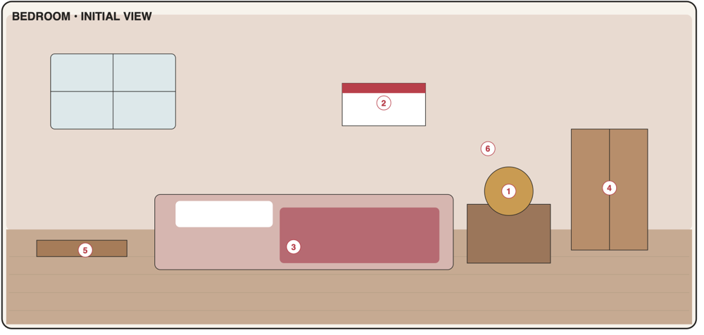

# Bedroom

Start location on first launch; its room tour ends onboarding and introduces the core interaction model (PDF p3). Ships in **Phase 1** (alarm clock, wall calendar) and **Phase 2** (bed, wardrobe, desk, medication tray).



## 1. Portrait layout

Palette: wall `#E8D9D1`, floor `#C7AB91`, floor line at **y = 0.58**.

```text
 safe zone 1080 × 1620 (2:3)
┌────────────────────────────────────┐ 0.00
│ ┌────┬────┐           ┌──────────┐ │
│ │    │    │  window   │▓▓ OCT ▓▓▓│ │ ← [2] wall calendar
│ ├────┼────┤           │    17    │ │
│ │    │    │           └──────────┘ │
│ └────┴────┘                        │
│ ┌─────────┐                        │ 0.30
│ │    ┊    │            ┌────────┐  │
│ │    ┊    │            │ 💊💊💊 │  │ ← [6] medication tray (wall shelf)
│ │ [4]┊    │ ┌────────┐ └────────┘  │
│ │ WARDROBE│ │ [5] 📓 │   ( 07:00 ) │ ← [1] alarm clock
│~│~~~~┊~~~~│~│  desk  │~┌────────┐~~│ 0.58 floor line
│ └─────────┘ └┬──────┬┘ │ night- │  │
│              │      │  │ stand  │  │
│ ┌────────────────────┐ └────────┘  │
│ │░pillow░  [3] BED   │       🙂    │ ← character (decorative)
│ │      ▒▒▒▒▒▒▒▒▒▒▒▒▒ │       /|\   │
│ └────────────────────┘       / \   │
└────────────────────────────────────┘ 1.00
```

### 1.1 Object map (normalised to safe zone)

| Code | Object id | x | y | w | h | z | Window |
|------|-----------|---|---|---|---|---|--------|
| B1 | `bedroom.alarm-clock` | 0.73 | 0.53 | 0.14 | 0.09 | 30 | `alarms.main` |
| B2 | `bedroom.wall-calendar` | 0.58 | 0.07 | 0.30 | 0.18 | 20 | `calendar.main` |
| B3 | `bedroom.bed` | 0.04 | 0.73 | 0.60 | 0.23 | 10 | `sleep.main` |
| B4 | `bedroom.wardrobe` | 0.04 | 0.30 | 0.30 | 0.38 | 10 | `wardrobe.main` |
| B5 | `bedroom.desk-notebook` | 0.38 | 0.46 | 0.28 | 0.16 | 20 | `tasks.main` |
| B6 | `bedroom.medication-tray` | 0.70 | 0.40 | 0.22 | 0.08 | 30 | `meds.main` |

Decor (not interactive): window (0.06, 0.06, 0.34, 0.20), nightstand (0.68, 0.62, 0.26, 0.15), desk chair, rug (0.10, 0.66, 0.50, 0.06 under bed edge), plant. Character anchor (feet) **(0.82, 0.96)**, height 0.30, pose `stand`.

---

## B1 · Alarm clock

| | |
|-|-|
| Object | `bedroom.alarm-clock` · window `alarms.main` (compact) · data `alarms`, `profile/sleepPlan` · **Phase 1, MVP** |
| PDF function | Set alarm time, repeat days, sound/vibration, enable or disable. The clock face updates after saving. |
| PDF window content | Time picker · repeat-day toggles · sound · enabled switch · Save |

**Scene and feedback**
- Clock face shows the **next enabled alarm time** (HTML text over the art, large digits) — PDF `feedback: clock_face_updates`. No enabled alarm → face shows "--:--" dimmed.
- After saving: digits flip animation (600 ms).
- Visual states: `idle`, `armed` (small bell icon on the clock), `ringing` (shake animation while the alarm overlay is open).
- aria-label: "Alarm clock, next alarm 07:00 tomorrow" / "Alarm clock, no alarm set".

**Root page**
1. *Next alarm* summary: "07:00 · in 7 h 20 min" or "No alarm set".
2. Alarm list (ordered by time). Row: time (large), label, repeat summary ("Weekdays", "Once", "Mon, Wed, Fri"), enabled toggle (autosaves). Primary alarm shows "🌙 Linked to sleep plan" when `sleepPlan.linkAlarm`.
3. **[🌙 Nightstand mode]** button (prominent when an alarm is set for the next 16 h): starts the low-power overnight mode ([03 §5.4](../03-ux-shell.md#54-alarm-overlay-and-nightstand-mode)).
4. Notice row (until dismissed): "Alarms ring only while Organized Life is open. Before sleeping, start Nightstand mode and put the phone on the charger." → explainer page.
5. Footer: [+ Add alarm] · [Done].

**Edit page (create/edit)**

| Field | Control | Req. | Default | Validation / notes |
|-------|---------|------|---------|--------------------|
| Time | TimeField (24 h/12 h per setting), big | ✓ | 07:00 for the first alarm; else last used time | `HH:MM` |
| Repeat | DayToggles + presets Once / Every day / Weekdays / Weekends | | Once | — |
| Label | TextField | | "" | ≤ 40 chars |
| Sound | Select + ▶ preview button | ✓ | Gentle chime | Preview plays 3 s at alarm volume |
| Vibrate | Toggle (hidden where `navigator.vibrate` unsupported, e.g. iOS) | | on | — |
| Snooze | Segmented 5 / 10 / 15 min | | 10 | — |
| Enabled | Toggle | | on | — |

Actions: **Save** → back to root, toast "Alarm set for 07:00 — in 7 h 20 min"; **Delete** (edit only) → removed + *Undo* toast. If the alarm is primary and linked: saving also updates `sleepPlan.wakeTime` (F-8), deleting asks "This alarm is linked to your sleep plan. Unlink and delete?".

**Rules and edge cases**
- One-shot alarm: next occurrence of `time` (today if still ahead, else tomorrow); after it fires and is dismissed → `enabled = false`.
- Several alarms at the same minute → one overlay listing all labels.
- Device time/zone change → next alarm recomputed on visibility change.
- DST: alarm fires at local wall-clock time; non-existent time (spring forward) fires at the next valid minute.
- Ringing, snooze and Nightstand mode: [03 §5.4](../03-ux-shell.md#54-alarm-overlay-and-nightstand-mode). Missed alarms: [05 §3](../05-cross-system.md#3-reminder-engine).

**Acceptance criteria**
- AC-B1-1 Creating an alarm with time and repeat days persists it; after app restart the list and the clock face show it.
- AC-B1-2 The clock face always shows the earliest upcoming enabled alarm across all alarms; toggling an alarm off updates the face immediately.
- AC-B1-3 With the app open (in normal or Nightstand mode) the alarm overlay appears within 1 s of the alarm minute, plays the selected sound, and Snooze re-fires after the snooze interval.
- AC-B1-8 Nightstand mode meets the low-power rules (black screen, no animations, ≤ 2 wake-ups per minute, scene unmounted) and an 8-hour overnight test on iPhone and Android (on charger) ends with the alarm ringing on time.
- AC-B1-9 Double-tap exits Nightstand mode; a single accidental tap does not.
- AC-B1-4 A one-shot alarm disables itself after being dismissed.
- AC-B1-5 Opening the app after a missed alarm shows "Missed alarm HH:MM" in the next-task strip until 12:00.
- AC-B1-6 Editing the primary linked alarm updates the sleep plan wake time and vice versa.
- AC-B1-7 All controls are reachable by keyboard/screen reader; the hit button announces the next alarm.

---

## B2 · Wall calendar

| | |
|-|-|
| Object | `bedroom.wall-calendar` · window `calendar.main` (tall) · data `events`, `tasks` (virtual deadlines) · **Phase 1, MVP** |
| PDF function | View month/week, events, deadlines, reminders; add or edit an event. |
| PDF window content | Month/week toggle · event list · + Add event · date/time · reminder |

**Scene and feedback**
- The calendar page shows today's **month abbreviation and day number** (HTML text).
- Badge (neutral): number of today's items (events + tasks due) if > 0.
- After saving: page-flip animation.

**Root page**
- Segmented **Month | Week** (remembers last choice).
- Header row: ‹ [October 2026] › and [Today].
- **Month view:** 6-row grid, week starts per setting; each day shows up to 3 coloured dots (event kinds/module colours) + "+" if more; today outlined; selected day filled. Below the grid: agenda list for the selected day.
- **Week view:** 7 day sections (vertical, portrait-friendly) with agenda rows.
- Agenda row: time or "All day", title, kind chip (Event/Deadline/Exam/Class/Reminder), 🔔 if reminder set, repeat icon if recurring. Virtual task rows show a checkbox (completes the task) and "Task" chip.
- Horizontal swipe on the grid changes month/week (with buttons as the accessible path).
- Footer: [+ Add event] (pre-fills the selected day) · [Done].

**Event page**

| Field | Control | Req. | Default | Validation / notes |
|-------|---------|------|---------|--------------------|
| Title | TextField | ✓ | — | ≤ 120 |
| Kind | Segmented Event / Deadline / Reminder (+ Exam / Class when Study is enabled) | ✓ | Event | — |
| All day | Toggle | | off (on for Deadline) | — |
| Date | DateField + chips Today / Tomorrow | ✓ | selected day | — |
| Start / End | TimeField ×2 | ✓ if not all-day | next full hour / +1 h | end > start, same day |
| Repeat | Select None / Daily / Weekly / Monthly / Yearly; Weekly shows DayToggles; "Until" DateField | | None | until ≥ date |
| Reminder | Select None / At time / 5 / 10 / 15 / 30 min / 1 h / 2 h / 1 day / 2 days / 1 week before | | 10 min (timed), 1 day (all-day deadline) | — |
| Location | TextField | | — | ≤ 120 |
| Module | Select (Study enabled, kinds Class/Exam/Deadline) | | — | — |
| Notes | TextArea | | — | ≤ 5000 |

Actions: **Save**; **Delete** — recurring events ask "Delete only this occurrence / all occurrences" (only this → add to `exDates`). Editing a recurring event edits the whole series (v1); the page says so.

**Rules and edge cases**
- Recurrence is expanded only for the visible range (+ the reminder window).
- Tasks with due dates appear as virtual items (F-10); tapping opens the task page in this sheet.
- Monthly on 31 → last day of shorter months.
- Many items per day: month cell shows max 3 dots + "+N".

**Acceptance criteria**
- AC-B2-1 Month and week views show events (including recurring occurrences) and due tasks for the visible range.
- AC-B2-2 Adding an event with date/time/reminder persists it and shows it immediately in both views; reminder fires in-app at the configured offset.
- AC-B2-3 Deleting one occurrence of a recurring event hides only that date.
- AC-B2-4 The calendar object shows today's date; the badge equals the number of today's items.
- AC-B2-5 Week starts on the configured weekday; all dates are formatted in the UI language.

---

## B3 · Bed

| | |
|-|-|
| Object | `bedroom.bed` · window `sleep.main` (tall) · data `profile/sleepPlan`, `sleepLogs`, `routines` (bedtime), `routineRuns`, `alarms` · **Phase 2, MVP** |
| PDF function | Sleep routine, target bedtime and wake time, optional manual sleep log. |
| PDF window content | Bedtime · wake time · routine checklist · Log sleep |

**Scene and feedback**
- Visual states: `made` (day), `turned-down` (from wind-down start until wake time) with a small 🌙 badge (info) while the bedtime routine is not complete, `slept` ✓ for the morning after a sleep log was saved (until noon).
- After saving the plan: pillow fluff animation.

**Header action (all tabs):** **[🌙 Go to sleep]** — records bedtime (`pendingBedAt = now`) and starts Nightstand mode; in the morning the "Good morning" card saves the sleep log in one tap (F-8). Shown from 18:00 to 04:00.

**Tabs**
1. **Plan**
   - Bedtime (TimeField, default 23:00), Wake time (TimeField, default 07:00), computed "Sleep goal: 8 h 00 min".
   - Wind-down reminder: Off / 15 / 30 / 45 / 60 min before bedtime.
   - "Use wake time as my alarm" toggle (`linkAlarm`) + DayToggles for alarm days (F-8). Shows the linked alarm summary.
   - Save button (form semantics).
2. **Routine** — bedtime routine (`slot: 'bedtime'`)
   - Today's checklist (CheckRow per step, autosave) with progress "2 / 3"; when complete: "All set — sleep well 🌙".
   - [Edit steps] page: add / rename / reorder (drag handle + up/down buttons) / delete steps; active days.
   - Reminder time is the wind-down time (read-only here, link to Plan).
3. **Log**
   - [Log sleep] page: Went to bed (date + time, default yesterday at `bedtime`), Woke up (date + time, default today at `wakeTime`), Quality (5 faces, optional), Notes. Duration computed live ("7 h 40 min").
   - Pending night (when *Go to sleep* was used): "Went to bed at 23:40 — waiting for morning" with [Discard].
   - List of the last 14 nights: date, duration bar vs goal, quality face; tap → edit/delete.
   - Summary: "Average last 7 nights: 7 h 12 min".

**Validation**
- `wakeAt > bedAt`, duration ≤ 16 h; one log per morning date (saving a duplicate offers "Replace the existing log?").

**Acceptance criteria**
- AC-B3-1 Saving bedtime/wake time persists; with "Use wake time as my alarm" the primary alarm is created/updated and the alarm clock face reflects it.
- AC-B3-2 Bedtime routine check-offs save immediately and reset per day; the wind-down reminder fires at bedtime − wind-down.
- AC-B3-3 Logging sleep computes duration, rejects invalid ranges, and appears in the 14-night list and 7-night average.
- AC-B3-4 The bed shows the turned-down state in the evening window and the ✓ state after a morning log.
- AC-B3-5 *Go to sleep* starts Nightstand mode; after the alarm is dismissed the "Good morning" card shows the computed night and saves it as a sleep log with one tap.

---

## B4 · Wardrobe

| | |
|-|-|
| Object | `bedroom.wardrobe` · window `wardrobe.main` (tall) · data `clothingItems`, `outfits`, `profile/character` · **Phase 2, MVP** ([D-07](../01-decisions.md#d-07-wardrobe-clothing-shop-and-laundry-model)) |
| Owner decision | The wardrobe shows **drawings of the real clothes the player owns**; the character's outfit is changed **here** |
| PDF function | Browse clothing, equip an outfit, save combinations. |
| PDF window content | Character preview · clothing categories · Equip · Save outfit |

**Scene and feedback**
- The character in **every** scene wears the equipped outfit (primary feedback).
- Badge: ✨ "New" when any item has `isNew` (from the clothing shop).
- Doors open briefly after Equip.

**Root page**
- **Character preview** (top ~40 % of the sheet): avatar wearing the *preview selection* (starts as equipped). Under it: [Reset] [Equip] (primary) [Save outfit].
- **Category chips:** All · Tops · Bottoms · Dresses · Outerwear · Shoes · Accessories · ★ Outfits.
- **Item grid** (3 columns): swatch + template icon + name; status corner badge: "Dirty" (warn), "In wash" (info); "New" ribbon.
- Tap item → toggles it in the preview (replaces the item in the same slot; selecting a dress clears top+bottom and vice versa).
- "⋯" on item → Edit · Mark as worn (→ dirty, F-7) · Favourite · Delete.
- Outfits tab: list with mini preview, name, tags; tap → loads into preview; "⋯" → Rename · Delete · Update with current preview.
- Footer: [+ Add clothing] · [Done].

**Add / edit clothing page**

| Field | Control | Req. | Default |
|-------|---------|------|---------|
| Name | TextField | ✓ | from template + colour ("Blue jeans") |
| Category (slot) | Segmented/Select | ✓ | current chip |
| Template | Picker with avatar-style icons filtered by slot | ✓ | first of slot |
| Colour | ColorSwatches (16) | ✓ | — |
| Laundry group | Segmented Whites / Lights / Darks / Colours | ✓ | derived from colour |
| Care | Select Normal / Delicate / Wool / Hand wash / Don't wash | ✓ | Normal (shoes/accessories: Don't wash) |
| Season | Segmented All / Summer / Mid / Winter | | All |
| Notes | TextArea | | — |

**Rules**
- **Equip** writes `character.equipped`; equipping an item that is dirty → confirm "This is in the laundry basket. Wear it anyway?"; `in_load` → "This is in the washing machine." (allowed after confirm).
- **Save outfit** → name prompt (default "Outfit 3"), optional tags; saves the preview selection.
- Deleting an equipped item un-equips it (slot falls back to the base layer).
- Opening the wardrobe clears `isNew` on items shown.

**Acceptance criteria**
- AC-B4-1 Selecting items updates the preview instantly; Equip persists and the scene character changes in all rooms.
- AC-B4-2 Save outfit stores the combination; loading it later reproduces the same preview.
- AC-B4-3 Category chips filter correctly; dirty/in-wash states are visible.
- AC-B4-4 Mark as worn moves the item to the laundry basket (F-7).

---

## B5 · Desk / notebook

| | |
|-|-|
| Object | `bedroom.desk-notebook` · window `tasks.main` (tall) · data `tasks`, `projects`, `notes` · **Phase 2, MVP** |
| PDF function | Homework, personal tasks, notes and project checklists. |
| PDF window content | Task title · due date · priority · notes · project checklist |

**Scene and feedback**
- Badge: count of tasks due today + overdue; tone `alert` if any overdue, else `neutral`.
- After completing a task: notebook page-turn animation.

**Tabs**
1. **Tasks**
   - Quick add field at top ("Add a task…", Enter = create with defaults in the current context filter).
   - Filter chips: Today · Upcoming · All · Done; context chips: Personal · Homework (· Study when enabled).
   - Sections: Overdue · Today · Tomorrow · Later · No date.
   - Row: CheckRow (completing autosaves, row stays struck-through for 1.5 s then moves to Done; *Undo* toast), title, due chip (red if overdue), ⚑ high priority, project chip, checklist progress "2/5".
2. **Projects**
   - Cards: name, colour, progress bar (done / total), next open task.
   - Project page: tasks checklist (quick add inside project), notes, [Archive], [Delete] (asks: "Keep its tasks (unassigned)" — default — or "Delete tasks too").
3. **Notes**
   - Search; pinned first, then by `updatedAt`.
   - Note page: title, body (autosizing TextArea, autosave 500 ms), pin toggle, delete (*Undo*).

**Task page**

| Field | Control | Req. | Default | Notes |
|-------|---------|------|---------|-------|
| Title | TextField | ✓ | — | ≤ 120 |
| Notes | TextArea | | — | |
| Due date | DateField + chips Today / Tomorrow / Next week / None | | none | |
| Due time | TimeField | | none | only with date |
| Reminder | Select (as events) | | none; "At due time" when a time is set | |
| Priority | Segmented Low / Normal / High | | Normal | |
| Context | Segmented Personal / Homework (/ Study) | ✓ | current filter | Study requires Module |
| Project | Select (+ "New project…") | | none | |
| Module | Select | ✓ if Study | — | |
| Checklist | Repeating rows: checkbox + text, add/reorder/delete | | — | ≤ 50 items |
| Status | Segmented To do / Doing / Done | | To do | |
| Grade | TextField (Study only) | | — | |

**Acceptance criteria**
- AC-B5-1 Quick add creates a task in one step; checking it off persists and can be undone.
- AC-B5-2 Due dates group tasks correctly (overdue/today/tomorrow/later); tasks with dates appear in the wall calendar.
- AC-B5-3 Projects show accurate progress; project checklist add/complete works inside the project page.
- AC-B5-4 Notes autosave while typing and survive a forced reload.
- AC-B5-5 Badge equals due-today + overdue count.

---

## B6 · Medication tray

| | |
|-|-|
| Object | `bedroom.medication-tray` · window `meds.main` (tall) · data `medications`, `doseLogs` · **Phase 2, MVP** |
| PDF function | Medication list and schedule, mark taken or skipped; simple history. |
| PDF window content | Medication name · prescribed schedule · taken/skipped · history |

**Scene and feedback**
- Tray state: `full` (no dose of today handled yet), `partial`, `empty` (all of today's doses taken or skipped).
- Badge: number of due/overdue doses; tone `warn` when due, `alert` when overdue.
- After marking taken: compartment "pops" empty.

**Tabs**
1. **Today**
   - Doses grouped by time ("08:00", "20:00"); row: colour dot, name, dose, instructions; buttons [Taken] [Skip] (autosave; then status chip "✓ Taken 08:12" / "Skipped" tappable to change or undo).
   - Overdue rows highlighted; future rows muted.
   - "As needed" section: [Log dose] per med → records taken now.
   - Day switcher (‹ Today ›) to fix yesterday's entries.
2. **Medications**
   - Active list: name, dose, schedule summary ("Every day 08:00, 20:00"), stock "12 left" (warn when ≤ refill).
   - Archived section (collapsed).
   - Footer: [+ Add medication].
3. **History**
   - Last 30 days grouped by day: per dose ✓ taken / – skipped / ○ missed; filter by medication.
   - "Taken on schedule (last 7 days): 13 of 14" — neutral wording, no colour judgement.

**Medication page**

| Field | Control | Req. | Default | Validation |
|-------|---------|------|---------|------------|
| Name | TextField | ✓ | — | ≤ 80 |
| Form | Select | ✓ | Pill | — |
| Dose | TextField ("1 tablet") | ✓ | — | ≤ 40 |
| Schedule type | Segmented Every day / Specific days / Every N days / As needed | ✓ | Every day | — |
| Times | Repeating TimeFields (+ Add time) | ✓ unless as needed | 08:00 | ≥ 1, unique |
| Days | DayToggles | ✓ for specific days | — | ≥ 1 day |
| Every N days | Number | ✓ for interval | 2 | 2–30 |
| Start / End date | DateField ×2 | start ✓ | today / none | end ≥ start |
| Instructions | TextField | | — | ≤ 120 |
| Stock / per intake / refill at | Number ×3 | | empty / 1 / empty | ≥ 0 |
| Colour | ColorSwatches | | first free colour | — |
| Active | Toggle | | on | — |

Delete → offers **Archive** (default, keeps history) or **Delete with history** (confirm).

**Rules**
- Dose states: [04 §3.7](../04-data-model.md#37-medications-doselogs). Reminders: banner at each time; overdue after 60 min (05 §3).
- Taken decrements stock (F-9); refill suggestion when `stock ≤ refillAt`.
- Persistent disclaimer at the bottom of Medications tab: "For personal tracking only. Always follow your doctor's instructions."
- Health data never leaves the device; backup export warns about sensitive content.

**Acceptance criteria**
- AC-B6-1 Adding a medication with times generates today's doses in the Today tab per schedule type (daily, specific days, every N days from start date, as needed).
- AC-B6-2 Taken/Skipped save immediately, can be changed, and appear in History.
- AC-B6-3 The tray badge shows due/overdue count and clears when all doses are handled.
- AC-B6-4 Stock decrements on Taken, restores on undo, and triggers a refill suggestion at the threshold.
- AC-B6-5 Archived medications stop generating doses but keep history.
