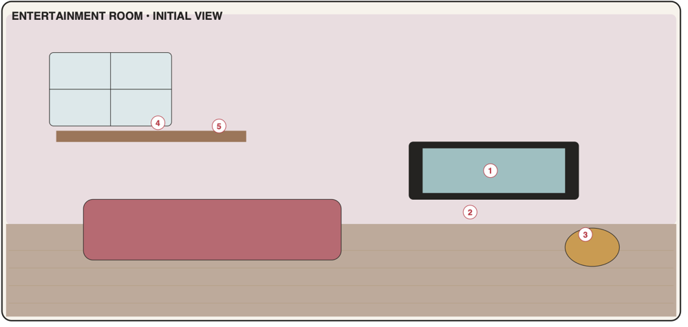

# Entertainment room

"Leisure tracking should feel inviting, not like another obligation dashboard" (PDF p9). Open from the start; the first visit runs the room tour. Ships in **Phase 5** together with achievements.

**Room-wide tone rules ([P-8](../00-product.md#2-product-principles-from-the-pdf-made-testable))**
- No overdue states, no red/`alert` badges, no streaks, no reminders by default.
- Copy is playful ("What should I watch tonight?"); random-pick buttons in TV, console and art windows.
- Empty states invite rather than instruct.



## 1. Portrait layout

Palette: wall `#EADCDF`, floor `#BBA898`, floor line at **y = 0.60**.

```text
┌────────────────────────────────────┐ 0.00
│          ┌────────────────────┐    │
│          │   [1] TELEVISION   │    │ ← [1] wall-mounted TV
│ ┌──────┐ │      ▶ title       │    │
│ │▥▥▥▥▥▥│ └────────────────────┘    │
│ │▥ [5]▥│                  ┌─────┐  │
│ │▥▥▥▥▥▥│   ┌────────────┐ │ /\  │  │ ← [4] art supplies (easel)
│ │BOOK- │   │ [2] ▭ 🎮   │ │/[4]\│  │
│ │SHELF │ ┌─┴────────────┴┐│  ┃  │  │
│~│▥▥▥▥▥▥│~│   TV stand    │~┃~~~~~~~│ 0.60
│ └──────┘ └───────────────┘  ┃  ┌──┐│
│                               │[3]││ ← [3] music player (record player)
│ ┌───────────────────────┐     └──┘│
│ │      sofa (decor)     │   🙂     │
│ └───────────────────────┘   /|\    │
└────────────────────────────────────┘ 1.00
```

### 1.1 Object map

| Code | Object id | x | y | w | h | z | Window |
|------|-----------|---|---|---|---|---|--------|
| E1 | `entertainment.television` | 0.30 | 0.06 | 0.48 | 0.20 | 10 | `media.screen` |
| E2 | `entertainment.game-console` | 0.38 | 0.42 | 0.26 | 0.08 | 20 | `media.games` |
| E3 | `entertainment.music-player` | 0.80 | 0.62 | 0.17 | 0.12 | 20 | `media.music` |
| E4 | `entertainment.art-supplies` | 0.76 | 0.32 | 0.20 | 0.28 | 10 | `creative.main` |
| E5 | `entertainment.bookshelf` | 0.04 | 0.20 | 0.22 | 0.46 | 10 | `media.shelf` |

Decor: TV stand (0.30, 0.50, 0.42, 0.10), sofa (0.06, 0.74, 0.62, 0.20), rug, floor lamp, posters. Character anchor **(0.84, 0.97)**, height 0.30 (Later: `sit` pose on the sofa).

---

## E1 · Television

| | |
|-|-|
| Object | `entertainment.television` · window `media.screen` (tall) · data `media` (kinds film, series) · **Phase 5, MVP** |
| PDF function | Film and series watchlist, watched status and ratings. |
| PDF window content | Films/series · watchlist · watched · rating · notes |

**Scene and feedback**: screen shows the title of the most recently updated "Watching" item (HTML text, 1 line, ellipsis); otherwise a soft idle glow. No badge.

**Root page**
- Segmented **Watchlist | Watching | Watched**; type chips All · Films · Series; ★ chip.
- Row: type icon, title, year, series progress "S2 · E5", rating stars (Watched).
- Row quick actions: Watchlist → [Start watching]/[Watched]; Watching series → [+1 episode]; Watching film → [Watched].
- [🎲 What should I watch?] picks a random Watchlist item (respecting type chip) and highlights it.
- Footer: [+ Add] · [Done].

**Item page**

| Field | Control | Req. | Notes |
|-------|---------|------|-------|
| Title | TextField | ✓ | ≤ 120 |
| Type | Segmented Film / Series | ✓ | |
| Status | Segmented Watchlist / Watching / Watched / Dropped | ✓ | → Watched sets `finishedAt` = today |
| Year | NumberField | | 1880–current+5 |
| Director / creator | TextField | | |
| Season / Episode | Stepper ×2 | | series only |
| Where to watch | TextField | | |
| Rating | Rating (1–5) | | |
| Favourite | Toggle | | |
| Collections | Multi-select | | |
| Link | URL field | | http(s) only |
| Notes | TextArea | | |

**Acceptance criteria**
- AC-E1-1 Films and series move between Watchlist, Watching and Watched; status changes save instantly.
- AC-E1-2 Series progress increments with one tap; rating and notes persist.
- AC-E1-3 Random pick only chooses from the Watchlist with the current filter.
- AC-E1-4 TV screen shows the current Watching title.

---

## E2 · Game console

| | |
|-|-|
| Object | `entertainment.game-console` · window `media.games` (tall) · data `media` (kind game) · **Phase 5, MVP** |
| PDF function | Game library and backlog. |
| PDF window content | Game list · playing/completed/paused · platform · notes |

**Scene and feedback**: console LED on when any game is Playing. No badge.

**Root page**
- Segmented **Playing | Backlog | Paused | Completed** (+ "Dropped" in ⋯ filter); platform chips.
- Row: title, platform chip, hours (if set), notes snippet; quick actions by status: Backlog → [Start], Playing → [Pause] [Completed], Paused → [Resume].
- [🎲 Pick from backlog].
- Footer: [+ Add game] · [Done].

**Game page**: Title ✓, Platform (Select PC / PlayStation / Xbox / Switch / Mobile / Other), Status ✓, Rating, Hours played (Number), Developer, Year, Favourite, Collections, Link, Notes. Status → Playing sets `startedAt` if empty; → Completed sets `finishedAt`.

**Acceptance criteria**
- AC-E2-1 Games can be added and moved across statuses with dates auto-set.
- AC-E2-2 Platform filter and status tabs combine correctly.
- AC-E2-3 Console LED reflects whether any game is Playing.

---

## E3 · Music player

| | |
|-|-|
| Object | `entertainment.music-player` · window `media.music` (tall) · data `media` (kinds track, album), `playlists` · **Phase 5, MVP** ([D-19](../01-decisions.md#d-19-music-player): tracker only, no audio) |
| PDF function | Tracks, albums, playlists and listening notes. |
| PDF window content | Playlist · favourites · albums · mood tags |

**Scene and feedback**: record spins and notes float while a playlist or item is marked **Now playing**; static otherwise.

**Root page**
- Mood chips (filter across tabs): calm, focus, energetic, happy, melancholy, party, sleep, workout + custom tags.
- Segmented **Playlists | Albums | Favourites**.
- Playlists: name, track count, mood tags, ▶ "Now playing" toggle (one at a time).
- Albums: title, artist, year, rating, status Want to listen / Listened.
- Favourites: favourite tracks and albums.
- Footer: [+ Add] (menu: Track · Album · Playlist) · [Done].

**Pages**
- **Playlist:** name ✓, mood tags, notes, external link (opens in a new tab/app), tracks list (reorder, remove), [Add tracks] picker (search existing tracks, or create new inline: title + artist).
- **Track / Album:** Type, Title ✓, Artist, Album (tracks), Year, Mood tags, Rating, Favourite, Status (albums), Link, Listening notes.

**Acceptance criteria**
- AC-E3-1 Playlists can be created with ordered tracks and mood tags; reordering persists.
- AC-E3-2 Mood filter narrows playlists, albums and favourites.
- AC-E3-3 "Now playing" animates the record player; only one playlist can be now playing.
- AC-E3-4 External links open outside the app; no audio is played.

---

## E4 · Art supplies

| | |
|-|-|
| Object | `entertainment.art-supplies` · window `creative.main` (tall) · data `creativeProjects`, writes `shoppingItems` · **Phase 5, MVP** |
| PDF function | Drawing, crafts and creative projects. |
| PDF window content | Project board · materials · next step · reference notes |

**Scene and feedback**: easel shows a sketch canvas when ≥ 1 project is In progress, blank otherwise.

**Root page (project board)**
- Segmented columns **Ideas | In progress | Done** (Paused projects appear in In progress with a "Paused" pill).
- Card: title, medium icon, **next step** line, materials "2 missing".
- Card actions: Ideas → [Start]; In progress → [Pause]/[Resume] · [Finish]; Done → [Reopen].
- [🎲 Inspire me] picks a random idea.
- Footer: [+ New project] · [Done].

**Project page**: Title ✓, Medium, Status, **Next step** (single prominent line: "What's the very next step?"), Materials checklist (name + have ✓; [Add missing to shopping list] → `shopCategory: hobby`, F-4), Reference notes (TextArea), Links (URL list), Started/Finished (auto, editable), Favourite, Collections.

**Acceptance criteria**
- AC-E4-1 Projects move between Ideas, In progress (incl. paused) and Done with dates auto-set.
- AC-E4-2 Next step is visible on the card; materials track have/missing.
- AC-E4-3 Missing materials can be added to the shopping list (hobby category) without duplicates.

---

## E5 · Bookshelf

| | |
|-|-|
| Object | `entertainment.bookshelf` · window `media.shelf` (tall) · data `media` (all kinds), `mediaCollections`, `achievementUnlocks` · **Phase 5, MVP** |
| PDF function | Collections, favourites and achievements. |
| PDF window content | Collections · favourites · achievements · item detail |
| Addition | **Books** tab ([DV-8](../00-product.md#7-deviations-from-the-pdf-and-why)) |

**Scene and feedback**
- Trophy shelf state by unlocked achievements: `trophies-none` (0), `trophies-some` (1–4), `trophies-many` (5+).
- Badge ✨ "New" when an achievement is unlocked and not yet seen.

**Tabs**
1. **Books:** segmented To read / Reading / Read; row: title, author, progress "p. 120 / 380", rating. Book page: Title ✓, Author, Status, Pages current/total, Rating, Favourite, Collections, Notes, Link.
2. **Collections:** list (colour, name, item count). Collection page: name, description, colour, items of any kind (films, series, games, music, books, creative projects) with type icons; [Add items] picker (search across all media + projects); remove.
3. **Favourites:** all favourited items grouped by kind (Films & series · Games · Music · Books · Projects).
4. **Achievements:** grid of badges ([05 §5](../05-cross-system.md#5-achievements)); unlocked: colour + date; locked: grey + hint ("Watch 10 films · 3/10"). Opening this tab marks unseen unlocks as seen.

**Item detail**: tapping any item in Collections/Favourites opens that kind's item page (shared components from E1–E4) inside this sheet.

**Acceptance criteria**
- AC-E5-1 Collections can contain mixed media and creative projects; adding/removing persists.
- AC-E5-2 Favourites shows every favourited item across kinds and opens its detail.
- AC-E5-3 Achievements unlock per rules, show a toast once, and the shelf shows the "New" badge until viewed.
- AC-E5-4 Books can be tracked through To read → Reading → Read.
