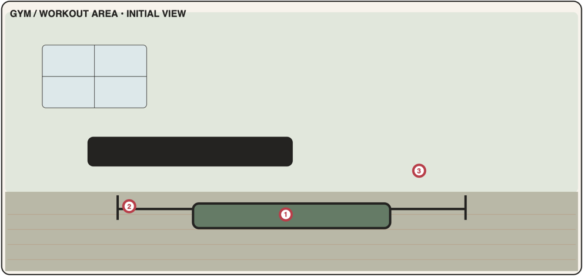

# Gym / Workout area

An optional training room. "Begin with manual tracking; integrations can come later" (PDF p13). Open from the start and shown by default (first visit runs the room tour); can be **hidden** in Settings → Places. Ships in **Phase 6**.



## 1. Portrait layout

Palette: wall `#E1E7DF`, floor `#B8B5A2` (rubber), floor line at **y = 0.62**.

```text
┌────────────────────────────────────┐ 0.00
│ ┌────┬────┐ ┌─────────────────────┐│
│ │    │    │ │ [3] PROGRESS BOARD  ││ ← [3] board with mini chart
│ ├────┼────┤ │  ▁▃▅▂▆  ✓✓✓·        ││
│ └────┴────┘ └─────────────────────┘│
│                                    │
│ ┌───────────────────┐   ┌────────┐ │
│ │   wall mirror     │   │ ●━━━●  │ │ ← [2] weights rack (dumbbells + barbell)
│ │   (decor)         │   │ ●━━━●  │ │
│ └───────────────────┘   │  [2]   │ │
│~~~~~~~~~~~~~~~~~~~~~~~~~│ ●━━━●  │~│ 0.62
│                         └────────┘ │
│  ┌──────────────────────────┐      │
│  │ ▬▬▬ [1] BENCH / MAT ▬▬▬  │  🙂  │ ← [1] bench + mat
│  └──────────────────────────┘  /|\ │
└────────────────────────────────────┘ 1.00
```

### 1.1 Object map

| Code | Object id | x | y | w | h | z | Window |
|------|-----------|---|---|---|---|---|--------|
| G1 | `gym.bench-mat` | 0.06 | 0.74 | 0.64 | 0.16 | 10 | `workouts.today` |
| G2 | `gym.weights` | 0.66 | 0.38 | 0.30 | 0.30 | 10 | `workouts.library` |
| G3 | `gym.progress-board` | 0.38 | 0.06 | 0.56 | 0.20 | 10 | `workouts.progress` |

Decor: window (0.06, 0.06, 0.26, 0.16), wall mirror (0.06, 0.34, 0.52, 0.18) — the black bar in the PDF —, water bottle, towel, kettlebell on floor. Character anchor **(0.84, 0.97)**, height 0.30.

---

## G1 · Workout bench / mat

| | |
|-|-|
| Object | `gym.bench-mat` · window `workouts.today` (tall) · data `workoutPlans`, `workoutSessions`, `exercises`, `profile/fitness` · **Phase 6, MVP** |
| PDF function | Workout plan, exercises, sets/reps/time and completion. |
| PDF window content | Today's workout · exercise · sets · reps · rest · complete |

**Scene and feedback**
- Mat shows a ✓ towel when today's workout is completed.
- Badge (info, gentle): "1" when a plan is scheduled today and not done. Never `alert`.
- During a session: badge with elapsed minutes.

**Tabs**
1. **Today**
   - *Before start:* scheduled plan(s) for today (or "No plan today" + [Choose plan] / [Empty workout]); plan preview: exercises with sets × reps/time, weight, rest; "Last time" hint per exercise.
   - [Start workout] → session view:
     - Exercise cards in order; each card: name, target ("3 × 10 @ 20 kg · rest 90 s"), set rows with inputs prefilled from the plan or last session (reps / weight / duration / distance per exercise metric) and a ✓ per set (autosave).
     - Checking a set starts the **rest timer** (sticky mini bar: "Rest 1:24" [−15 s] [+15 s] [Skip]); chime at the end.
     - [+ Set], [+ Exercise] (library picker), card ⋯: Replace with substitution · Remove.
     - Session notes; elapsed time in the header.
     - [Finish workout] → summary: duration, completed sets, volume (Σ reps × weight), new PRs 🎉 → [Done]. [Abandon] (confirm) sets `abandoned`.
2. **Plans**
   - List: name, weekdays, exercise count; [+ New plan].
   - Plan page: Name ✓, Scheduled days (DayToggles), Exercises (add from library; per item: sets ✓ 1–20, reps or duration (by metric), weight (optional), rest seconds (default 90 strength / 30 cardio)), reorder, Notes, Archive.

**Rules**
- Units: weight stored in kg, shown in kg or lb (Settings).
- One session `in_progress` at a time; it survives reloads; on next day start, an unfinished session asks "Finish or discard yesterday's workout?".

**Acceptance criteria**
- AC-G1-1 A plan scheduled for today appears on the Today tab and can be started.
- AC-G1-2 Set check-offs save instantly and start the rest timer with the configured rest.
- AC-G1-3 Finishing shows duration, volume and newly set personal records; the session appears in Progress → History.
- AC-G1-4 Plans can be created, edited, scheduled on weekdays and archived.

---

## G2 · Weights

| | |
|-|-|
| Object | `gym.weights` · window `workouts.library` (tall) · data `exercises`, `profile/fitness`, `workoutSessions` (for suggestions) · **Phase 6, MVP** |
| PDF function | Equipment filter and exercise library. |
| PDF window content | Equipment filter · exercise suggestions · substitutions |

**Scene and feedback**: static. No badge.

**Root page**
- **Equipment filter** chips (multi-select): Bodyweight · Mat · Dumbbells · Barbell · Kettlebell · Bands · Bench · Pull-up bar · Machine · Cardio machine. Default = "My equipment" from `profile/fitness` ([Save as my equipment] when changed).
- **Muscle** chips: Chest · Back · Shoulders · Arms · Core · Legs · Glutes · Full body · Cardio.
- **Suggested for you** (top, 3 cards): exercises available with my equipment for the muscle groups least trained in the last 7 days (fallback: full body).
- Exercise list (filtered): name, equipment icons, primary muscle.
- Footer: [+ Custom exercise] · [Done].

**Exercise page**: name, type, metric, equipment, muscles, how-to (short text), **Substitutions** (explicit + computed: same primary muscle and type, available with my equipment), actions [Add to today's workout] (starts/extends the current session) · [Add to plan…]. Custom exercises editable/deletable; seeded ones read-only except a "Hide" option.

**Acceptance criteria**
- AC-G2-1 Equipment and muscle filters combine (AND across groups, OR within a group).
- AC-G2-2 Substitutions only list exercises doable with the selected equipment.
- AC-G2-3 Suggestions change after logging workouts for the suggested muscle group.

---

## G3 · Progress board

| | |
|-|-|
| Object | `gym.progress-board` · window `workouts.progress` (tall) · data `workoutSessions`, `walks` (activity days), `profile/fitness` · **Phase 6, MVP** |
| PDF function | Workout history, personal records and trends. |
| PDF window content | History · consistency · personal records · trend chart |

**Scene and feedback**: board's mini bar chart = last 6 weeks of workout counts; badge (neutral) "2/3" this week vs goal.

**Tabs**
1. **Consistency:** this week "2 of 3 workouts" ring; weeks-in-a-row meeting the goal; 12-week heatmap (Mon–Sun rows × weeks; workout = strong tone, walk-only day = light tone, F-13); weekly goal Stepper (writes `profile/fitness.weeklyGoal`).
2. **History:** sessions by date: plan name, duration, sets, volume; tap → read-only detail with [Edit] (fix numbers) and [Delete].
3. **Records:** per exercise: heaviest weight, best estimated 1RM (Epley), most reps, longest time; date achieved; "New" pill for records set in the last 7 days.
4. **Trends:** exercise Select → LineChart of top-set weight (or est. 1RM toggle) over time; second chart: weekly volume BarChart (last 12 weeks). Charts have text summaries for screen readers ("Bench press est. 1RM rose from 50 kg to 57.5 kg since August").

**Acceptance criteria**
- AC-G3-1 History lists completed sessions newest first; edits recompute records.
- AC-G3-2 Records are derived correctly (unit-tested incl. Epley and kg/lb display).
- AC-G3-3 Consistency counts workouts per ISO week against the goal; heatmap includes walks in a lighter tone.
- AC-G3-4 Trend chart renders for any exercise with ≥ 2 sessions; otherwise shows an empty-state hint.
