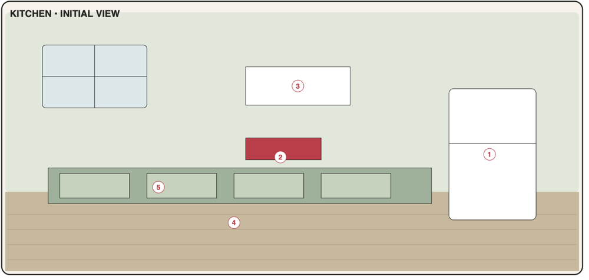

# Kitchen

Food tools tied to the fridge, recipe book, shopping board, dining table and cabinets (PDF p5). Open from the start; the first visit runs the room tour. Ships in **Phase 3** with the Town economy (grocery shop, bank).



## 1. Portrait layout

Palette: wall `#E1E6DD`, floor `#C8B898`, floor line at **y = 0.60**.

```text
┌────────────────────────────────────┐ 0.00
│ ┌────┬────┐   ┌───────────────┐    │
│ │    │    │   │ ▢ milk ▢ eggs │    │ ← [3] shopping board (cork + notes)
│ ├────┼────┤   │ ▢ bread  ▢ …  │    │
│ │    │    │   └───────────────┘    │
│ └────┴────┘                ┌──────┐│
│ ═[2]═📕══ shelf            │      ││ ← [1] refrigerator (tall)
│                            │ ──── ││
│ ┌──────────────────────┐   │ [1]  ││
│ │ ▣ stove   ◯ sink     │   │      ││
│ │┌────┐┌────┐┌────┐    │   │      ││
│~││[5] ││    ││    │~~~~│~~~│~~~~~~││ 0.60
│ │└────┘└────┘└────┘    │   └──────┘│
│ └──────────────────────┘           │
│     ┌──────────────────────┐       │
│     │  🍽  [4] DINING TABLE │  🙂   │
│     └─┬──────────────────┬─┘  /|\  │
│       │                  │    / \  │
└────────────────────────────────────┘ 1.00
```

### 1.1 Object map

| Code | Object id | x | y | w | h | z | Window |
|------|-----------|---|---|---|---|---|--------|
| K1 | `kitchen.refrigerator` | 0.70 | 0.30 | 0.27 | 0.42 | 10 | `inventory.fridge` |
| K2 | `kitchen.recipe-book` | 0.08 | 0.31 | 0.24 | 0.08 | 20 | `recipes.main` |
| K3 | `kitchen.shopping-board` | 0.40 | 0.06 | 0.36 | 0.18 | 20 | `shopping.main` |
| K4 | `kitchen.dining-table` | 0.14 | 0.76 | 0.56 | 0.18 | 10 | `diary.main` |
| K5 | `kitchen.cabinets` | 0.04 | 0.52 | 0.60 | 0.14 | 20 | `inventory.pantry` |

Decor: window (0.06, 0.06, 0.28, 0.18), wall shelf (0.06, 0.39, 0.30, 0.02), counter top with stove and sink (0.04, 0.44, 0.60, 0.08), chairs at the table, fruit bowl on table. Character anchor **(0.84, 0.96)**, height 0.30.

---

## K1 · Refrigerator

| | |
|-|-|
| Object | `kitchen.refrigerator` · window `inventory.fridge` (tall) · data `inventoryItems` (`fridge`, `freezer`), `products` · **Phase 3, MVP** |
| PDF function | Food inventory, quantity, expiry dates, quick add/remove. |
| PDF window content | Inventory · quantity · expiry · Add item · Mark used |

**Scene and feedback**
- Badge: number of items expiring today/tomorrow (`warn`) or expired (`alert`, takes precedence).
- Visual states: `default`, `empty` (no items: fridge door slightly open, empty-shelf light).
- After add/use: door bump animation.

**Root page**
- Segmented **Fridge | Freezer**; sort Select: Expiring first (default) · Name · Category.
- "Expiring soon" section (≤ 2 days, includes expired) on top, then the rest by sort.
- Row: category icon, name, quantity + unit with Stepper (−/+ step 1 for pcs/pack, 100 for g/ml, 0.1 for kg/l; autosave), expiry chip ("Expired", "Today", "Tomorrow", "in 5 d", "—").
- Row "⋯": Mark used · Edit · Move to freezer/fridge · Delete (*Undo*).
- Footer: [+ Add item] · [Done].

**Add / edit item page**

| Field | Control | Req. | Default | Notes |
|-------|---------|------|---------|-------|
| Name | TextField with product autocomplete | ✓ | — | selecting a product fills unit/category/shelf life |
| Quantity | NumberField + Stepper | ✓ | product default or 1 | > 0 |
| Unit | Select | ✓ | product default or pcs | — |
| Place | Segmented Fridge / Freezer | ✓ | current tab | — |
| Category | Select (food categories) | ✓ | product's | — |
| Expiry | DateField + chips +3 d / +1 w / +1 m / None | | today + shelf life (pre-filled, editable) | may be in the past (warning only) |
| Opened on | DateField | | — | — |
| Alert when ≤ | NumberField | | empty | enables low-stock suggestions |
| Notes | TextField | | — | — |

Saving merges with an identical batch (same product/name, place, unit, expiry) — the page says "Added to existing Milk (now 2 l)".

**Mark used page**: [Used all] (removes or sets 0) or amount Stepper + [Save]; P2 toggle "Log as meal" (F-5).

**Acceptance criteria**
- AC-K1-1 Items added appear in the correct tab with quantity, unit and expiry; restart keeps them.
- AC-K1-2 Stepper changes persist instantly; reaching 0 removes the item (or keeps "Out" when it has a threshold).
- AC-K1-3 Expiring/expired items sort to the top and drive the fridge badge.
- AC-K1-4 Grocery checkout (F-1) adds/merges items here without duplicates of identical batches.

---

## K2 · Recipe book

| | |
|-|-|
| Object | `kitchen.recipe-book` · window `recipes.main` (tall) · data `recipes`, reads `inventoryItems`, writes `shoppingItems` · **Phase 3, MVP** (Cook = P2) |
| PDF function | Recipes, ingredients, servings and cooking steps. |
| PDF window content | Recipe cards · ingredients · servings · cooking steps · add missing items |

**Scene and feedback**: no badge. After adding missing items: a small bookmark flies toward the shopping board (reduced motion: none).

**Root page**
- SearchField; tag chips (from recipe tags); ★ Favourites chip.
- Recipe cards (one column): title, servings, total time, tags, availability line "✓ You have everything" / "Missing 3".
- Empty state: "No recipes yet. [Add recipe] [Add 3 sample recipes]" (Omelette, Tomato pasta, Overnight oats — localised, flagged as samples).
- Footer: [+ Add recipe] · [Done].

**Recipe detail page**
- Title, ★, tags, times.
- **Servings** Stepper (1–50): scales displayed ingredient quantities (rounded sensibly: pcs to 0.5, g to 5, ml to 5); does not change the stored recipe.
- **Ingredients** list with availability mark per row: ✓ in stock · ✗ missing (shows missing amount) · ~ check (units not comparable) · *optional* label.
- **Steps**: numbered; tapping a step toggles a "done" mark (cooking mode, not persisted).
- Notes.
- Actions: [Add missing to shopping list (N)] (F-2, disabled when N = 0) · [Cook] (P2, F-3) · Edit · Delete (*Undo*).

**Recipe edit page**

| Field | Control | Req. | Validation |
|-------|---------|------|------------|
| Title | TextField | ✓ | ≤ 120 |
| Servings | Stepper | ✓ | 1–50 |
| Prep / Cook minutes | NumberField ×2 | | 0–1440 |
| Tags | Chips input (suggest existing) | | ≤ 10 |
| Ingredients | Repeating rows: quantity, unit, name (product autocomplete), optional checkbox; add/reorder/delete | ✓ ≥ 1 | name required per row |
| Steps | Repeating TextAreas, reorder | | ≤ 50 |
| Notes | TextArea | | |

**Acceptance criteria**
- AC-K2-1 Recipes can be created, edited and deleted; servings scaling updates quantities without saving.
- AC-K2-2 Availability marks match current fridge/freezer/pantry stock using the matching rules (05 §1).
- AC-K2-3 "Add missing" adds exactly the missing amounts, merges with existing unchecked list items, and can be undone.

---

## K3 · Shopping board

| | |
|-|-|
| Object | `kitchen.shopping-board` · window `shopping.main` (tall) · data `shoppingItems`, `products`, suggestions from inventory/meds/creative · **Phase 3, MVP** |
| PDF function | Shopping list grouped by category; check items off. |
| PDF window content | Categories · quantities · priority · checkbox · estimated total |

**Scene and feedback**
- Board state by unchecked items: `none` (0), `few` (1–3 notes), `many` (4+ notes).
- Badge (neutral): number of unchecked items.

**Root page**
- Summary line: "12 items · ≈ 34.50 €" (estimated total of unchecked items; "≈" when any line uses a product's last price).
- Quick add field ("Add item…", product autocomplete; P2 parser "2 kg apples" → qty 2, unit kg, name apples).
- Groups by shop category in a fixed aisle order (produce, bakery, dairy, meat & fish, frozen, pantry, drinks, snacks, household, personal care, pharmacy, hobby, other); empty groups hidden.
- Row: CheckRow, name, "2 kg", ❗ high priority, price estimate (muted). Checking autosaves and moves the row to **In cart** (bottom section, struck-through).
- **Suggestions** (collapsible, F-4): low-stock items, medication refills, missing creative materials — each with [+], plus [Add all].
- Footer: [Go shopping] (F-14, travels to Town) · [Finish shopping (N)] (shown when N checked; opens `checkout.page`, F-1) · [Done]. "⋯" menu: Clear checked (*Undo*), Uncheck all.

**Item page**

| Field | Control | Req. | Default |
|-------|---------|------|---------|
| Name | TextField + autocomplete | ✓ | — |
| Quantity / Unit | NumberField + Select | ✓ | product default or 1 pcs |
| Category | Select (shop categories) | ✓ | product's or Other |
| Priority | Segmented Low / Normal / High | | Normal |
| Estimated price | MoneyField (line total) | | product last price × qty (placeholder) |
| Note | TextField | | — |

**Acceptance criteria**
- AC-K3-1 Items are grouped by category; checking/unchecking persists instantly.
- AC-K3-2 Estimated total equals the sum of line estimates of unchecked items.
- AC-K3-3 Suggestions list low-stock/refill/material items not already on the list; adding them works individually and in bulk.
- AC-K3-4 "Finish shopping" runs checkout with the checked items and updates inventory and the bank (F-1).

---

## K4 · Dining table

| | |
|-|-|
| Object | `kitchen.dining-table` · window `diary.main` (tall) · data `meals`, `recipes` · **Phase 3, MVP** |
| PDF function | Food diary and daily nutrition summary. |
| PDF window content | Meal type · food · portion · notes · daily summary |

**Scene and feedback**: plates on the table = number of main meals logged today (0–3) (`data-state="plates-0..3"`). No badge (no pressure).

**Root page**
- Day switcher ‹ Today ›.
- **Daily summary card:** Breakfast ✓ / Lunch ✓ / Dinner – / Snacks 2; if any nutrition entered: kcal total (vs target from Settings if set, ring), protein/carbs/fat totals.
- Meals grouped by type in day order; row: time, food, portion, kcal (if any).
- "Recent" chips (last 8 distinct foods) for one-tap re-logging into the current meal type.
- Footer: [+ Add meal] · [Done].

**Meal page**

| Field | Control | Req. | Default |
|-------|---------|------|---------|
| Meal type | Segmented Breakfast / Lunch / Dinner / Snack | ✓ | by time: < 10:30 breakfast, < 15:00 lunch, 17:00–21:30 dinner, else snack |
| Time | TimeField | | now |
| Food | TextField + autocomplete (previous foods, recipes) | ✓ | — |
| Portion | TextField ("1 bowl", "200 g") | | — |
| Nutrition (collapsed) | kcal, protein g, carbs g, fat g | | — (copied from last identical food) |
| Recipe | Select | | — |
| Notes | TextArea | | — |

**Acceptance criteria**
- AC-K4-1 Meals save per date and type; the summary updates immediately.
- AC-K4-2 Nutrition totals only count entered values; no target → no ring.
- AC-K4-3 Recent chips re-log a food with its last portion and nutrition.

---

## K5 · Kitchen cabinets

| | |
|-|-|
| Object | `kitchen.cabinets` · window `inventory.pantry` (tall) · data `inventoryItems` (`pantry`) · **Phase 3, MVP** |
| PDF function | Dry goods and pantry inventory with low-stock reminders. |
| PDF window content | Pantry list · stock level · storage location · low-stock alert |

**Scene and feedback**
- Badge: low/out item count (`warn`).
- Cabinet doors: closed; after stock change a door wiggles.

**Root page**
- Low-stock banner (when any): "3 items are running low — [Add to shopping list]" (F-4).
- Group toggle: **By place** (storage spot: "Top shelf", "Drawer", "No place") · **By category**.
- Row: name, quantity + Stepper, **stock level pill** Full / OK / Low / Out (only when a threshold is set), expiry chip if set.
- Footer: [+ Add item] · [Done].

**Item page**: as K1 with Place fixed to Pantry, category from pantry categories (grains, canned, spices, snacks, drinks, baking, sauces, other), plus **Storage location** TextField with suggestions of existing spots, and **Alert when ≤** default 1 for pcs/pack.

**Acceptance criteria**
- AC-K5-1 Stock level is computed from quantity vs threshold (Out / Low / OK / Full) and shown per item.
- AC-K5-2 Low-stock banner adds all low/out items not already on the list to the shopping board.
- AC-K5-3 Grouping by storage location and by category both work and persist as the last choice (session).
