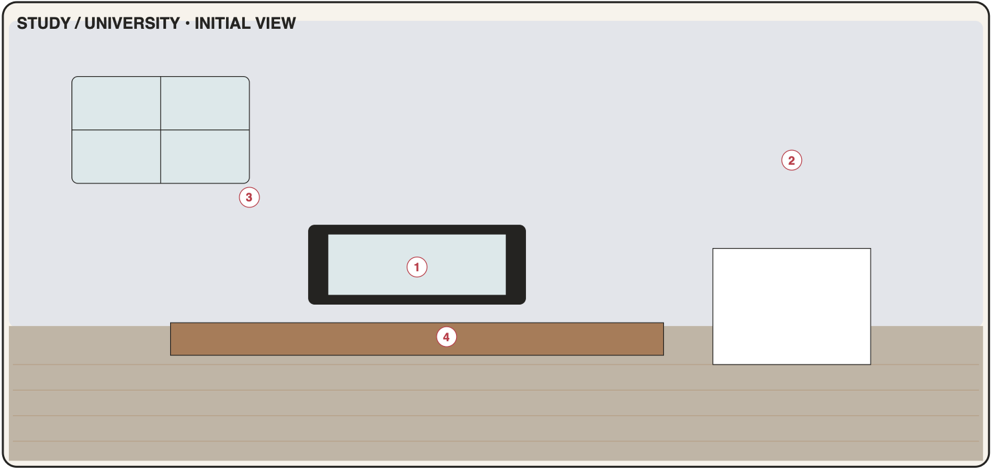

# Study / University

An optional focused space for modules, assignments, exams and study sessions (PDF p11). Open from the start and shown by default (first visit runs the room tour); can be **hidden** in Settings → Places. Ships in **Phase 6**.

When Study is hidden, study data (assignments, classes, exams, notes) remains visible in the bedroom desk and the wall calendar; only the room and its objects are hidden (F-11).



## 1. Portrait layout

Palette: wall `#E4E4EA`, floor `#BDB2A4`, floor line at **y = 0.62**.

```text
┌────────────────────────────────────┐ 0.00
│ ┌────┬────┐  ┌───────────────────┐ │
│ │    │    │  │ [2] PLANNER  M T W│ │ ← [2] wall planner / timetable board
│ ├────┼────┤  │  ▭▭  ▭   ▭▭  ▭    │ │
│ └────┴────┘  └───────────────────┘ │
│ ┌──────┐                           │
│ │▥▥▥▥▥▥│      ┌──────────────┐     │
│ │▥ [3]▥│      │ [1] COMPUTER │     │ ← [1] monitor on the desk
│ │▥▥▥▥▥▥│      │   ▤▤▤▤▤      │     │
│ │SHELF │      └──────┬───────┘┌───┐│
│ │▥▥▥▥▥▥│ ┌───────────┴────────│[4]││ ← [4] desk planner + focus timer
│~│▥▥▥▥▥▥│~│        DESK        └───┘│ 0.62
│ └──────┘ └─┬──────────────────┬───┘│
│            │      chair       │    │
│   🙂       │                  │    │
│  /|\                               │
└────────────────────────────────────┘ 1.00
```

### 1.1 Object map

| Code | Object id | x | y | w | h | z | Window |
|------|-----------|---|---|---|---|---|--------|
| S1 | `study.computer` | 0.40 | 0.32 | 0.34 | 0.20 | 20 | `study.main` |
| S2 | `study.planner` | 0.40 | 0.06 | 0.54 | 0.18 | 10 | `study.planner` |
| S3 | `study.bookshelf` | 0.04 | 0.28 | 0.24 | 0.42 | 10 | `study.resources` |
| S4 | `study.desk-planner` | 0.78 | 0.50 | 0.18 | 0.10 | 30 | `focus.main` |

Decor: window (0.06, 0.06, 0.28, 0.16), desk (0.32, 0.56, 0.64, 0.18), chair, desk lamp (on during focus sessions), pinboard. Character anchor **(0.16, 0.97)**, height 0.30.

The label of S3 in the Objects list is **"Study bookshelf"** to distinguish it from the entertainment bookshelf.

---

## S1 · Computer

| | |
|-|-|
| Object | `study.computer` · window `study.main` (tall) · data `studyModules`, `tasks` (`context: study`), `events` (exams, classes) · **Phase 6, MVP** |
| PDF function | Modules, assignments, project links and next actions. |
| PDF window content | Modules · assignments · status · project links · next action |

**Scene and feedback**
- Monitor shows the next deadline countdown text ("Essay · 2 d").
- Badge: count of assignments due within 2 days (`warn`) or overdue (`alert`).

**Tabs**
1. **Modules**
   - Cards: colour stripe, name, code, **next action** line (override text, else the earliest open assignment "Essay draft · due Fri"), counts "3 open · exam in 12 d".
   - Module page: Name ✓, Code, Colour, Teacher, Term, Credits, **Project links** (label + URL list, open externally), Next action override, Notes; sections: Assignments (filtered), Upcoming exams & classes, Resources count → [Open study bookshelf]; [Archive module].
2. **Assignments**
   - Sections: Overdue · This week · Later · No date · Done (collapsed).
   - Row: CheckRow (Done = "Submitted"), title, module chip (colour), due chip, status pill To do / In progress / Submitted, grade.
   - Add/edit uses the shared task page with Context fixed to Study and Module required.
- Footer: [+ Module] / [+ Assignment] (per tab) · [Done].

**Acceptance criteria**
- AC-S1-1 Modules can be created with colour and project links; links open externally.
- AC-S1-2 Next action shows the override or the earliest open assignment.
- AC-S1-3 Assignments are tasks with `context: study` and appear in the bedroom desk (Study filter) and the wall calendar.
- AC-S1-4 Badge reflects assignments due within 2 days / overdue.

---

## S2 · Planner

| | |
|-|-|
| Object | `study.planner` · window `study.planner` (tall) · data `events` (`class`, `exam`, `deadline`), `tasks` (study) · **Phase 6, MVP** |
| PDF function | Timetable, deadlines and exam dates. |
| PDF window content | Weekly timetable · deadlines · exams · reminders |

**Scene and feedback**: board shows today's class count as small blocks; badge (info) = today's classes count.

**Tabs**
1. **Timetable** (portrait-friendly): weekday chips M T W T F (S S if any weekend classes) with today selected → vertical list of that day's classes: time range, module colour, title, room. [Week overview] toggles a compact 5/7-column mini-grid (read-only).
   - Class page: Module ✓, Title (default module name), Weekdays ✓ (DayToggles), Start/End ✓, Location/room, Term start (date) / Term end (until), Reminder (default 10 min), Notes → saved as one weekly recurring `event` (`kind: class`).
2. **Deadlines:** study tasks with due dates + `deadline` events with `moduleId`, sorted, countdown chips ("in 3 d").
3. **Exams:** `exam` events: module, date, time, location, countdown "in 12 days"; Exam page: Module ✓, Title (default "<Module> exam"), Date ✓, Time, Location, Reminder (default 1 day), Notes.

**Acceptance criteria**
- AC-S2-1 A class created for Mon+Wed 10:00–11:30 appears on those weekdays in the timetable and in the wall calendar until the term end.
- AC-S2-2 Deadlines combine study tasks and deadline events in one sorted list.
- AC-S2-3 Exams show countdowns and fire reminders at the configured offset.

---

## S3 · Bookshelf (study)

| | |
|-|-|
| Object | `study.bookshelf` · window `study.resources` (tall) · data `studyResources`, `notes` (`context: study`) · **Phase 6, MVP** |
| PDF function | Module folders, reading list, references and notes. |
| PDF window content | Folders · reading list · resources · notes |

**Scene and feedback**: a book sticks out of the shelf when any resource is "Reading". No badge.

**Root page**: folder list — one per active module (colour, name, counts) + "General". Footer: [+ Resource] · [Done].

**Folder page** — segmented **Reading list | Resources | Notes**
- Reading list: resources with status To read / Reading / Done (CheckRow → Done).
- Resources: all resources incl. `reference`; row: type icon, title, author; actions: Open link, [Copy citation].
- Notes: study notes for the module (same note editor as the desk, autosave).

**Resource page**: Title ✓, Type, Author, URL (http/https), Citation (TextArea), Status (To read / Reading / Done / Reference only), Module (folder), Notes.

**Acceptance criteria**
- AC-S3-1 Resources are grouped by module folder; General holds resources without a module.
- AC-S3-2 Reading list status changes persist; citations copy to clipboard with a confirmation toast.
- AC-S3-3 Study notes created here also appear in the desk Notes tab (filtered by context).

---

## S4 · Desk planner

| | |
|-|-|
| Object | `study.desk-planner` · window `focus.main` (tall) · data `focusSessions`, `tasks` · **Phase 6, MVP** |
| PDF function | Focused work sessions and progress tracking. |
| PDF window content | Task list · focus session · break reminder · completion log |

**Scene and feedback**
- While a session runs: desk lamp on, timer badge (`info`) "18'" minutes left; during break: badge "☕".
- After completion: small confetti on the planner (reduced motion: none).

**Root page**
1. **Focus timer card:** big ring + remaining time; presets 25/5 · 50/10 · Custom (focus 5–120, break 1–30); selected task chip.
   - Controls: [Start] → running; [Pause]/[Resume]; [Stop] (confirm → `aborted` if < 50 % done, else `completed` with actual minutes).
   - End of focus: chime + banner "Time for a 5-min break" [Start break] [Skip]; end of break: "Back to work?" [Start next] [Done for now].
2. **Task list:** open study tasks due soon (then personal "doing" tasks), tap to select for the session; [Mark done].
3. **Completion log:** today's sessions (time, task, minutes, ✓/aborted), totals "Today 1 h 40 min · This week 6 h 15 min"; tap → edit note / delete.

**Rules**
- Timer is timestamp-based (`startedAt`, `pausedTotalSec`) so it survives reloads; if the app was closed past the end, the session is completed at its planned end and the user sees "Session finished while you were away".
- One running session at a time.

**Acceptance criteria**
- AC-S4-1 A 25/5 session runs, survives an app reload, and logs as completed with 25 minutes.
- AC-S4-2 Break reminder appears at focus end (in-app) and the break timer runs.
- AC-S4-3 Completion log totals per day/week are correct; finishing can mark the linked task done.
