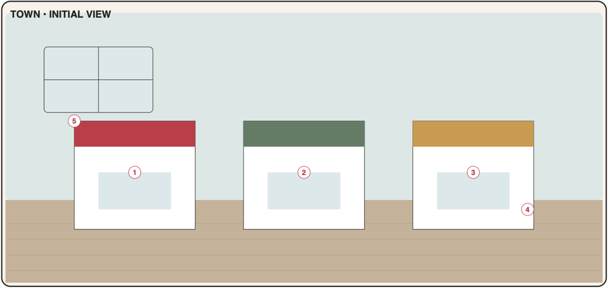

# Town

Outdoor 2D scene: buildings and landmarks are interactive objects like room furniture (PDF p15). Open from the start; the first visit runs the room tour. Grocery shop, Bank/ATM and Map sign ship in **Phase 3**; Clothing shop and Park in **Phase 4**.



## 1. Portrait layout

Palette: sky `#DDE7E6`, ground/street `#C4B19A`, horizon at **y = 0.36**. The PDF's indoor window is removed ([DV-5](../00-product.md#7-deviations-from-the-pdf-and-why)).

```text
┌────────────────────────────────────┐ 0.00
│   ☁        🌳🌳        ┌─────────┐ │
│  ┌─────────────────┐   │▓▓ BANK ▓│ │ ← [3] bank / ATM (back row)
│  │ [4] PARK  ⛲ 🌳 │   │  [3] 🏧 │ │
│  │   bench  🌳     │   │         │ │
│  └─────────────────┘   └─────────┘ │
│~~~~~~~~~~~~~~ sidewalk ~~~~~~~~~~~~│ 0.36
│ ┌───────────────┐ ┌───────────────┐│
│ │▓▓▓ GROCERY ▓▓▓│ │▓▓ CLOTHING ▓▓▓││ ← awnings: red / green
│ │  [1]  🍎🥖    │ │  [2]  👕 👗   ││
│ │  ┌───┐        │ │  ┌───┐        ││
│ └──┴───┴────────┘ └──┴───┴────────┘│
│ ════════════ street ═══════════════│
│             ┌──┐                   │
│             │[5]│ map sign    🙂   │ ← [5] signpost
│             └┬─┘             /|\   │
└────────────────────────────────────┘ 1.00
```

### 1.1 Object map

| Code | Object id | x | y | w | h | z | Window |
|------|-----------|---|---|---|---|---|--------|
| T1 | `town.grocery-shop` | 0.03 | 0.40 | 0.46 | 0.30 | 10 | `shop.grocery` |
| T2 | `town.clothing-shop` | 0.51 | 0.40 | 0.46 | 0.30 | 10 | `shop.clothing` |
| T3 | `town.bank-atm` | 0.56 | 0.06 | 0.40 | 0.30 | 10 | `finance.main` |
| T4 | `town.park` | 0.04 | 0.10 | 0.44 | 0.24 | 10 | `walks.main` |
| T5 | `town.map-sign` | 0.38 | 0.76 | 0.18 | 0.20 | 20 | `map.main` |

Decor: clouds, trees, street with crossing, street lamp, bus stop. Shop awning colours from the PDF: grocery `#B83C48`, clothing `#667E66`, bank `#C99A50`. Character anchor **(0.82, 0.98)**, height 0.28.

---

## T1 · Grocery shop

| | |
|-|-|
| Object | `town.grocery-shop` · window `shop.grocery` (tall) + page `checkout.page` · data `products`, `shoppingItems`, writes `inventoryItems`, `transactions` · **Phase 3, MVP** |
| PDF function | Buy food and household items; purchases update inventory and budget. |
| PDF window content | Product categories · quantity · price · buy · update fridge |

**Scene and feedback**: shop window shows "Open" sign; badge (neutral) = unchecked shopping-list items count (reminder that a list exists). After checkout: bag-pop animation over the door.

**Root page**
- **From your list (N)** section (expanded when opened via *Go shopping*): unchecked shopping items; [+] adds the line to the basket with list quantity; [Add all].
- SearchField: finds products; if none — "Add 'oat milk' as new product" → mini page (name, category, unit, default place, price).
- **Category chips/grid:** Produce · Bakery · Dairy · Meat & fish · Frozen · Pantry · Drinks · Snacks · Household · Personal care · Pharmacy · Hobby · Other (+ ★ Favourites).
- Product row: name, last price ("1.29 € / 1 l"), Stepper to put quantity in the basket.
- **Basket bar** (sticky above footer when not empty): "Basket · 7 items · 23.40 €" → [Checkout].

**Checkout page (`checkout.page`, shared with *Finish shopping*, F-1)**

| Section | Content |
|---------|---------|
| Lines | name · quantity + unit (editable) · line price MoneyField (pre-filled: last price × qty) · destination chip Fridge / Freezer / Pantry / Bathroom / Don't track (default from product) · expiry chip (pre-filled from shelf life, editable, "—" allowed) · remove ✕ |
| Totals | Σ lines; **Actual total paid** MoneyField (defaults to Σ; difference distributed per F-1) |
| Payment | Account Select (Wallet default), Date (today) |
| Result | [Buy] → success page "Bought 7 items · −23.40 € · Fridge +4 · Pantry +2 · Bathroom +1" [Done]; *Undo* toast 10 s |

Validation: ≥ 1 line; quantities > 0; prices ≥ 0 (0 allowed for gifts/free items); total ≥ 0.

**Acceptance criteria**
- AC-T1-1 Buying creates expense transaction(s) by finance category, adds/merges inventory per destination, updates product last prices, and auto-checks matching shopping-list items — in one atomic step with a single Undo.
- AC-T1-2 "From your list" mirrors unchecked shopping items; adding all puts them in the basket with list quantities.
- AC-T1-3 After buying, the fridge/cabinet badges, shopping board count and bank balance reflect the purchase without reload.
- AC-T1-4 Actual total different from Σ lines is recorded exactly (cents preserved).

---

## T2 · Clothing shop

| | |
|-|-|
| Object | `town.clothing-shop` · window `shop.clothing` (tall) · data writes `clothingItems`, `transactions`, `profile/character` · **Phase 4, MVP** ([D-07](../01-decisions.md#d-07-wardrobe-clothing-shop-and-laundry-model)) |
| PDF function | Browse, preview and buy clothing for the wardrobe. |
| PDF window content | Browse · try on · price · purchase · equip later |

**Scene and feedback**: mannequin in the shop window wears the most recently bought item. After purchase: bag-pop animation; wardrobe gets the ✨ "New" badge.

**Root page**
- **Try-on preview** (top 40 %): character wearing equipped outfit + the item being tried.
- Slot chips: Tops · Bottoms · Dresses · Outerwear · Shoes · Accessories.
- Template grid (avatar-style icons, [04 §3.12](../04-data-model.md#312-clothing-wardrobe-laundry)); tapping a template tries it on in the selected colour.
- Colour swatches (16) → updates the try-on.
- [Buy…] → purchase page.

**Purchase page**

| Field | Control | Req. | Default |
|-------|---------|------|---------|
| Name | TextField | ✓ | "Green hoodie" (template + colour) |
| Price paid | MoneyField | ✓ | — (0 allowed: "gift") |
| Date | DateField | ✓ | today |
| Account | Select | ✓ | Wallet |
| Laundry group / care / season | as wardrobe item | | derived |

Actions: [Buy — wear later] (adds to wardrobe with `isNew`) · [Buy & wear] (also equips). Both create a `transaction` in Clothing unless price is 0.

**Acceptance criteria**
- AC-T2-1 Try-on changes only the preview, never the equipped outfit.
- AC-T2-2 Buying adds a wardrobe item (with "New" badge) and an expense in Clothing; Buy & wear also equips it.
- AC-T2-3 Price 0 creates the item without a transaction.

---

## T3 · Bank / ATM

| | |
|-|-|
| Object | `town.bank-atm` · window `finance.main` (tall) · data `accounts`, `transactions`, `financeCategories`, `budgets` · **Phase 3, MVP** |
| PDF function | View balance, transactions, categories and budget. |
| PDF window content | Balance · transactions · categories · monthly budget |

**Scene and feedback**
- ATM screen shows the balance only if Settings → "Show balance on ATM" is on (privacy, default off); otherwise a "$" glyph.
- Badge `warn` when this month's spending ≥ 80 % of the total budget, `alert` when > 100 %.

**First open**: prompt "What's your current balance in Wallet?" (MoneyField, can be 0, [Skip]) → `openingBalanceMinor`.

**Tabs**
1. **Overview**
   - Balance (large, all non-archived accounts).
   - This month: Spent · Income · Left in budget (if a budget exists).
   - Top categories this month (BarChart, max 5 + "Other"), recent 5 transactions.
   - Buttons [+ Expense] [+ Income].
2. **Transactions**
   - Month switcher; filter chips: All · Expenses · Income · by category (Select).
   - Grouped by day; row: category icon, note or category name, source icon (🛒 grocery, 👕 clothing), amount (expenses with "−").
   - Transaction page: Type ✓ (Expense/Income), Amount ✓ (> 0), Category ✓, Date ✓, Account ✓, Note. Deleting a grocery/clothing transaction warns: "Items stay in your inventory/wardrobe."
3. **Budget**
   - Month switcher. Total limit (MoneyField) + per-category limits list (category, limit, progress bar spent/limit with % text; amber ≥ 80 %, red > 100 %).
   - A new month without a budget auto-copies the previous month's limits on first view (toast "Budget copied from September").
   - [Manage categories] page: add/rename/recolour/archive/reorder categories (seeded ones can be renamed or archived, not deleted).

**Rules**: integer minor units everywhere; currency from Settings; formatting with `Intl.NumberFormat(locale, {style: 'currency'})`. Multiple accounts are P2 (Accounts page: add Card/Bank/Savings with opening balances).

**Acceptance criteria**
- AC-T3-1 Balance = opening balance + income − expenses, always consistent after any add/edit/delete/undo (unit-tested).
- AC-T3-2 Grocery and clothing purchases appear as transactions with source icons.
- AC-T3-3 Monthly budget progress per category and total is correct; a new month copies last month's limits.
- AC-T3-4 No floating-point errors: 0.10 + 0.20 shows 0.30.

---

## T4 · Park / landmark

| | |
|-|-|
| Object | `town.park` · window `walks.main` (compact) · data `walks`, `places` · **Phase 4, MVP** |
| PDF function | Start a walk, add a manual step log, explore a location. |
| PDF window content | Walk session · optional step log · notes |

**Scene and feedback**: while a walk runs, the character's mini icon appears on the park path and a badge shows elapsed minutes (`info`). No GPS (see *Rules* below).

**Tabs**
1. **Walk**
   - Idle: [Start walk] (place Select, default last used, e.g. "Park").
   - Running: elapsed time (timestamp-based), place, [Finish]. Finish → summary page: Duration (auto, editable), Steps (optional Number), Distance km (optional), Notes → [Save].
   - [Log a past walk] → same page with Date, Start time, Duration manual.
2. **History:** list of walks (date, place, duration, steps); weekly totals "This week: 2 h 10 min · 18 400 steps".
3. **Places** ("explore a location"): list of places with visit count, last visit, notes, favourite; [+ Place]. Place page: name ✓, notes, favourite, list of walks there.

**Rules**: no geolocation or motion sensors in v1 (privacy, background limits); steps are manual. One running walk at a time; survives reloads.

**Acceptance criteria**
- AC-T4-1 A walk can be started, survives reload, and finishing stores duration with optional steps and notes.
- AC-T4-2 Past walks can be logged manually; weekly totals are correct.
- AC-T4-3 Places accumulate visit counts from walks.

---

## T5 · Map sign

| | |
|-|-|
| Object | `town.map-sign` · window `map.main` (compact) · data `profile/settings` (`optionalRooms`, `toursSeen`, `lastLocationId`) · **Phase 3, MVP** (the same window is opened by the top-bar location button from Phase 1) |
| PDF function | Choose destination and transition to another location. |
| PDF window content | Destinations · unlocked places · travel transition (all places are open — [D-09](../01-decisions.md#d-09-location-availability-and-room-tours)) |

**Scene and feedback**: signpost arrows; a small "New" flag while some location hasn't been visited yet.

**Window**: [03 §6](../03-ux-shell.md#6-navigation-and-routing) — sections Home / Out, thumbnails, current and "New" (not yet visited) states, hidden rooms with *Show*. Selecting a destination closes the sheet and runs the travel transition; a first visit then starts that room's tour.

**Acceptance criteria**
- AC-T5-1 Every shipped, non-hidden location is selectable; not-yet-visited ones show "New".
- AC-T5-2 Travel transition completes in ≤ 300 ms (instant with reduced motion) and the new location is restored on next launch.
- AC-T5-3 Showing a hidden Study or Gym from the map adds it immediately.
- AC-T5-4 The first arrival in a location starts its room tour; later arrivals don't.
